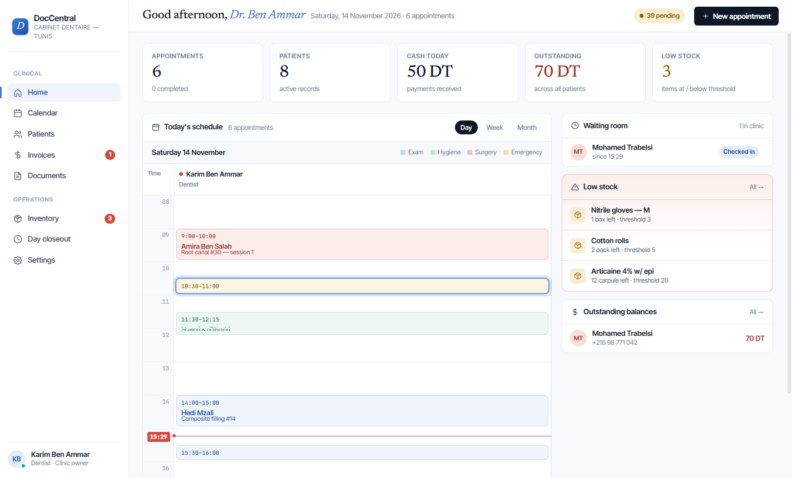
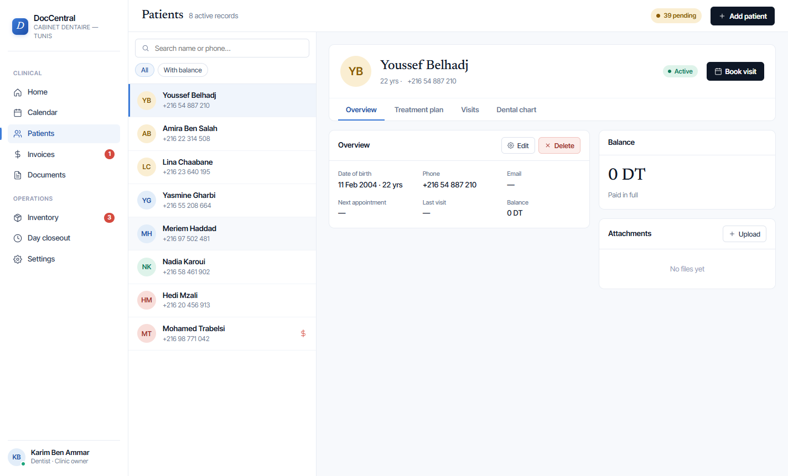
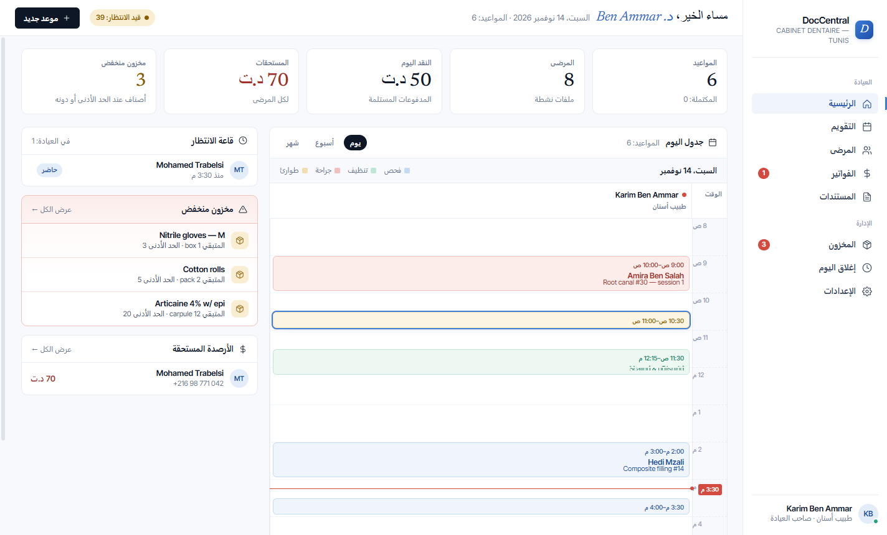

<p align="center">
  
</p>

<h1 align="center">DocCentral Desktop</h1>

<p align="center">
  Dental clinic management for Windows — patients, calendar, billing and stock,<br>
  working offline and kept in sync across the clinic's computers.
</p>

<p align="center">
  <a href="https://github.com/AlaaAbdelbaki/doccentral-desktop/actions/workflows/ci.yml"></a>
  
  
</p>



## Contents

- [Features](#features)
- [Requirements](#requirements)
- [Quick start](#quick-start)
- [Configuration](#configuration)
- [Project layout](#project-layout)
- [How it works](#how-it-works)
- [Development](#development)
- [Testing](#testing)
- [Releasing](#releasing)
- [Troubleshooting](#troubleshooting)
- [License](#license)

## Features

- **Patients** — records, treatment plans, visit history, dental chart, attachments.
- **Calendar** — day, week and month views; booking, check-in, cancellation and no-shows.
- **Visits and billing** — completing a visit creates the invoice; partial payments and outstanding balances.
- **Inventory** — stock levels, restocking, adjustments and low-stock alerts.
- **Day closeout** — expected vs counted cash, with history; a closed day can be reopened.
- **Staff and roles** — the clinic owner adds staff, who sign in on their own computers.
- **Offline-first** — everything works without internet; changes sync every minute once back online.
- **Safe data** — crash-proof saves, a backup per day, automatic recovery from a damaged database.
- **English, French and Arabic** — with a full right-to-left layout in Arabic; follows the Windows language by default.

| Patients | Arabic (right-to-left) |
| --- | --- |
|  |  |

*Screenshots use the built-in demo data.*

## Requirements

- **Windows 10 or 11** to run the app (the installer is Windows-only).
- For development: **Node.js 24** (what CI uses) and npm. `npm install` also
  downloads Electron (about 100 MB).
- For sync between computers: a **Supabase** project (see
  [Configuration](#configuration)). Without it the app still works on a
  single computer.

## Quick start

```bash
git clone https://github.com/AlaaAbdelbaki/doccentral-desktop.git
cd doccentral-desktop
npm install
npm start          # builds the UI and opens the app
```

To try it without an account, start it with demo data in a throw-away
folder:

```bash
DOC_DEV_AUTOLOGIN=1 DOC_DATA_DIR=./.demo-data npm start           # Git Bash
```

```powershell
$env:DOC_DEV_AUTOLOGIN=1; $env:DOC_DATA_DIR='.demo-data'; npm start  # PowerShell
```

## Configuration

### Supabase project

The project URL and the publishable (anon) key are in
[`src/lib/config.js`](src/lib/config.js). To use another Supabase project,
change both values there and rebuild. The publishable key is meant to be
public: the database is protected by the Row Level Security rules below, not
by the key.

### Database setup (once per Supabase project)

In the Supabase SQL editor, run in order:

1. [`supabase/migrations/0001_init_doccentral.sql`](supabase/migrations/0001_init_doccentral.sql) — tables
2. [`supabase/migrations/0002_clinic_isolation_and_sync.sql`](supabase/migrations/0002_clinic_isolation_and_sync.sql) — access rules and sync

Or copy both at once from the app: **Settings → Data & sync → Copy migration
SQL**. Both scripts are safe to run again. A project that already holds
exactly one clinic has its existing rows assigned to it automatically.

### Where data is stored

| What | Where |
| --- | --- |
| Database | `%APPDATA%\DocCentral\doccentral.db` |
| Daily backups (newest 7) | `%APPDATA%\DocCentral\backups\` |

Uninstalling keeps this folder.

## Project layout

```
main.js                 Electron main process: window, IPC, dev flags
preload.js              The only bridge between the UI and the database
db.js                   SQLite (sql.js): schema, migrations, atomic saves, backups, recovery
src/
  index.jsx, app.jsx    UI entry point and routing
  shell.jsx             Sidebar, top bar, sync indicator
  pages/                One file per screen (home, calendar, patients, invoices, …)
  components.jsx        Shared UI pieces (status pills, money and date formatting, …)
  lib/
    repos.js            Business rules: visits, invoices, payments, stock, closeout
    dbx.js              Query helpers over the IPC bridge
    auth.jsx, access.js Sign-in and who may open the app on this computer
    sync-core.js        Sync logic (push, pull, conflicts), independent of Supabase
    sync.js             Supabase adapter and sync scheduling
    translate.js        t() translator; locales/fr.js, locales/ar.js
    seed.js             Demo data
supabase/migrations/    Cloud database schema and access rules
scripts/                Translation audit, icon rendering
build/                  App icon (SVG source and generated PNG)
tests/unit/             Node tests: persistence, access rules, sync, translations
tests/e2e/              Playwright tests driving the real app
docs/                   Architecture notes and screenshots
```

## How it works

The short version — details in **[docs/architecture.md](docs/architecture.md)**:

- The UI talks to a **local SQLite database** in the Electron main process
  through a small IPC bridge; the app is fully usable offline.
- **Sync** runs every minute and on reconnect: local changes are pushed,
  other computers' changes are pulled using a server-side timestamp (device
  clocks aren't trusted). If two computers edit the same record, the newest
  edit wins.
- **Supabase Row Level Security** keeps each clinic's data visible only to
  its members. Nobody can join another clinic on their own, and records are
  never hard-deleted.
- **Saves are atomic** and backed up daily; a damaged database is detected
  on start-up and restored from the newest backup.

## Development

### Commands

| Command | What it does |
| --- | --- |
| `npm start` | Build the UI and run the app |
| `npm run build` | Bundle the UI only (`dist/bundle.js`) |
| `npm run test:unit` | Unit and integration tests |
| `npm run test:e2e` | End-to-end tests on the real app |
| `npm run test:e2e:report` | Open the last end-to-end report (screenshots and videos) |
| `npm run pack` | Unpacked app in `release/win-unpacked/` for a quick check |
| `npm run dist` | Windows installer in `release/` |
| `npm run icons` | Regenerate the icon PNGs from `build/*.svg` |

### Dev flags

Environment variables read when running from source. **The installed app
ignores them.**

| Variable | Effect |
| --- | --- |
| `DOC_DEV_AUTOLOGIN=1` | Skip Supabase; create a dev clinic with demo data |
| `DOC_DATA_DIR=<dir>` | Use another data folder (separate database) |
| `DOC_PAGE=<page>` | Open on a page (`home`, `calendar`, `patients`, …) |
| `DOC_SCREENSHOT=<file.png>` | Save a screenshot of the window, then quit |
| `DOC_SCREENSHOT_DELAY=<ms>` | Wait before the screenshot (default 2500) |

Demo data can also be loaded from **Settings → Data & sync → Load demo data**
when the database is empty.

### Adding UI text

Every user-facing string goes through `t()`:

```js
t('Save')
t('{n} appointments', { n })   // translate whole sentences, never fragments
```

Add the English key and its translation to both
[`src/lib/locales/fr.js`](src/lib/locales/fr.js) and
[`src/lib/locales/ar.js`](src/lib/locales/ar.js), then run
`node scripts/i18n-audit.mjs` to list anything missed. In CSS, use logical
properties (`margin-inline-start`, not `margin-left`) so the Arabic layout
stays correct.

### Workflow

1. Branch from `main` (`feat/…`, `fix/…`, `docs/…`, `chore/…`).
2. Open a pull request. Put any manual checks in the description as
   `- [ ]` task boxes.
3. CI must pass before merging:
   - **unit** — `npm run test:unit` on Linux;
   - **e2e** — the full Playwright suite on Windows (report attached to the run);
   - **checklist** — fails while any task box in the description is unticked.

## Testing

```bash
npm run test:unit        # ~30 s, no Supabase needed
npm run test:e2e         # ~3 min, opens the app windows
npm run test:e2e:report
```

- **Unit and integration** (`tests/unit`): atomic saves, backups and
  recovery; the cloud access rules and two-computer sync against a real
  Postgres running in-process (PGlite); sign-in access decisions;
  translation coverage.
- **End-to-end** (`tests/e2e`): Playwright drives the real Electron app with
  a fresh demo database per test — every page, booking, billing and payments,
  inventory, day closeout, every screen in Arabic and French, and the default
  language. Each test records step screenshots and a video.

## Releasing

1. Bump the version: `npm version <x.y.z> --no-git-tag-version`.
2. Merge to `main` through a pull request.
3. Build the installer from `main`: `npm run dist` →
   `release/DocCentral-Setup-<version>.exe`.

The installer installs per user (no admin rights needed) and keeps the data
folder on update and uninstall.

## Troubleshooting

**Windows says "Windows protected your PC".**
The installer isn't code-signed yet. Click **More info → Run anyway**. This
goes away once the app is signed.

**"Your data was restored from a backup" on start-up.**
The database was damaged (for example by a disk error). The app restored the
newest daily backup and kept the damaged file as
`doccentral.db.corrupt-<timestamp>` in the data folder. Changes made after
that backup come back from the cloud on the next sync, if sync is set up.

**Restoring an older backup by hand.**
Close the app, copy a file from `%APPDATA%\DocCentral\backups\` over
`%APPDATA%\DocCentral\doccentral.db`, and start the app again.

**"This account is not a member of …" when signing in.**
A computer holds one clinic, and only that clinic's members can sign in on
it. Ask the clinic owner to add you under **Settings → Team & roles**.

**Sync shows an error or never finishes.**
Open **Settings → Data & sync**. If it says the cloud isn't set up, run the
[database setup](#database-setup-once-per-supabase-project). Otherwise check
the internet connection; pending changes are kept and sent later.

**The app is in the wrong language.**
**Settings → Language**: pick one, or choose *Same as this computer* to
follow Windows.

**Starting over on a computer.**
Close the app and delete or rename `%APPDATA%\DocCentral`. If the clinic is
synced, signing in downloads it again.

## License

Proprietary — all rights reserved. See [LICENSE](LICENSE); no use, copying
or distribution without written permission.
